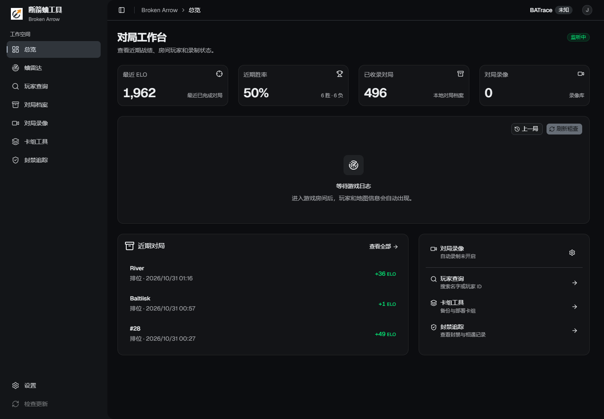
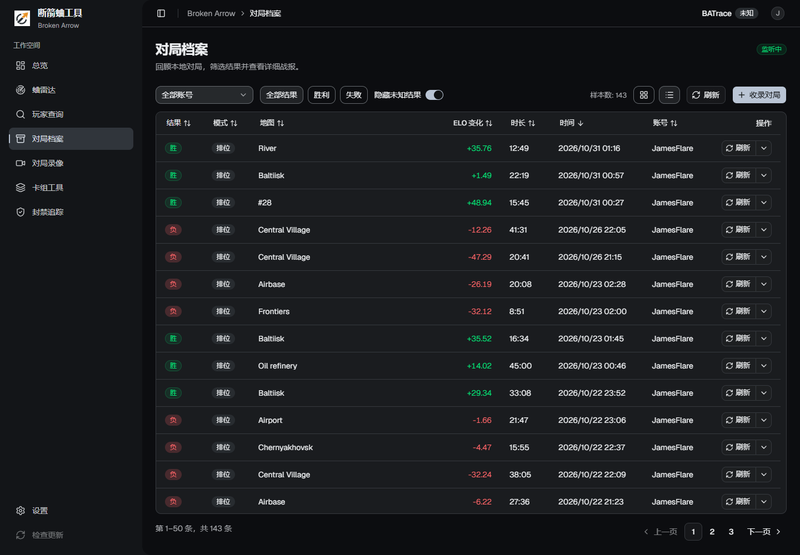
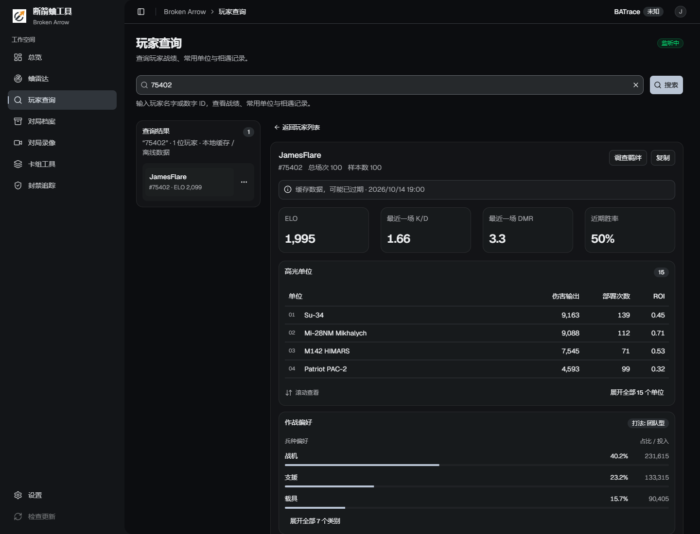

# BARadar · 断箭蛐工具


BARadar 是本地 Broken Arrow 对局助手。它从 GameLogs 增量读取房间、队伍、地图、账号、卡组和对局记录，在 Windows 桌面显示，无需把日志上传到服务器。

## 功能

- **对局**：查看当前房间、上一局和历史档案；按账号筛选，查看评分、时间线和多个录像视角。没有在线 ID 的旧对局仍可查看本地保存的阵容、时长、点数和卡组，但不能刷新 BATrace 数据。
- **玩家**：搜索玩家，查看粗查报告、最近对局、调查羁绊、改名历史及封禁追踪，可选封禁提醒。蛆指数需要最近 12 场有效五人队排位；缺少本人、完整 MVP 或足够样本时，不生成替代分数。BATrace 历史数据可能延迟数天。
- **卡组**：备份与部署卡组，开局时自动覆盖唯一的「上一局卡组包」，并在换号时提醒。
- **录像**：默认关闭；开启后录制所选显示器的整个画面，可混录系统声音和默认麦克风。支持 720–2160p、30–120 fps；质量分数越低画质越高。新录像保存为本地 MP4，旧 WebM 仍可播放、定位和迁移目录。
- **外观**：支持中英文、跟随系统或单独设置明暗配色。设置自动保存；侧栏可折叠、拖动调宽或双击复位。跨页面的样式规则见[界面设计系统](design-system/broken-arrow/MASTER.md)。

## Screenshots

以下截图来自运行中的浏览器开发版，使用[仓库内录制的数据](tests/fixtures/real/README.md)。

### Overview



### Match archive



### Player analysis



### Appearance settings


## 开发

使用 Node.js 24 LTS 和项目指定的 pnpm（版本见 [`package.json`](package.json)）。安装依赖时会安装对应版本的 Electron。

```sh
pnpm install
pnpm dev
```

`pnpm dev` 启动 Vite 和 Electron，通过 sandboxed preload 和类型化 IPC 访问本地服务。只开发前端时，运行 `pnpm dev:web`，在浏览器打开 `http://127.0.0.1:5174/`。

两种开发模式都为真实样本创建隔离的可写副本，不修改本机应用数据库。刷新查询也使用离线响应，缺失的数据会报错。浏览器不提供原生目录选择、真实录制和安装更新。开发工具可模拟房间、录制、加载和缓存过期状态；这些控件不进入正式版。样本来源、校验及 `data:import`、`data:capture` 的用法见[真实数据说明](tests/fixtures/real/README.md)。

| 命令                   | 用途                                      |
| ---------------------- | ----------------------------------------- |
| `pnpm format:check`    | 检查格式                                  |
| `pnpm check`           | 类型、界面规范、Vitest 回归和三个生产构建 |
| `pnpm test:ui`         | 在 Chromium 操作真实界面                  |
| `pnpm smoke`           | 验证真实 Electron、原生桥和窗口           |
| `pnpm smoke:real`      | 在 Electron 中重放离线档案与时间线        |
| `pnpm smoke:recording` | 用合成画面、音频验证编码和播放            |
| `pnpm pack:desktop`    | 生成 Windows 解包目录                     |
| `pnpm dist`            | 生成 NSIS 安装包与便携版                  |

首次运行浏览器测试前执行 `pnpm exec playwright install chromium`；也可设置 `BA_BROWSER_CHANNEL=chrome` 使用本机 Chrome。失败时从 `.test-data/playwright/` 查看截图，使用 `pnpm exec playwright show-trace <path-to-trace.zip>` 打开追踪文件。

## 应用更新与发布

Windows 正式版自动检查 GitHub Releases，但不会自动安装。安装版支持应用内下载、校验和重启安装；对局或录制进行中不能重启安装。便携版只提示可用版本，需退出后手动替换 EXE。开发、离线冒烟不会检查更新；`BA_DISABLE_AUTO_UPDATE=1` 可关闭正式版更新。

稳定版通过推送与根 `package.json` 一致的 `vX.Y.Z` 标签发布；手动运行工作流只生成产物。安装包、便携版、`latest.yml` 和 `.blockmap` 必须配套提供。见[发布与验证约定](AGENTS.md#releases)。本地冒烟不会替换已安装的应用；验证真实升级需在隔离的 Windows 用户环境中从旧安装版升级。

## 请求与数据

BATrace 的独立请求可并发，相同缓存键与刷新模式的请求共享进行中的调用。缓存命中不发请求，手动刷新绕过缓存；失败重试遵循退避和 `Retry-After`。服务默认值见 [`app.config.json`](app.config.json)。

数据保存在原 `broken-arrow-log-assistant` 用户目录的 SQLite 中；旧 JSON 先备份，再以事务导入，不修改原文件。

## Optional anonymous analytics

Packaged online desktop builds can send usage and diagnostic events to Aptabase only after consent. Sessions are temporary and do not use account hashes, installation IDs or persistent user tags. Events queue in memory; disabling analytics cancels requests and clears the queue. Resource and long-task sampling requires foreground activity. Development, browser fixtures, offline mode and smoke tests do not send events. `BA_DISABLE_ANALYTICS=1` also disables collection in packaged builds.

## English

BARadar is a local Broken Arrow assistant for match analysis, player history, deck backups and recordings. Run `pnpm install` and `pnpm dev` for the offline desktop development app; `pnpm check` runs regression tests and builds. The interface supports Chinese and English.

## 致谢与参考

作者 Zola；数据由 [BATrace](https://dash.batrace.top/) 提供。第三方代码的来源和许可见 [Third-party notices](THIRD_PARTY_NOTICES.txt)。
